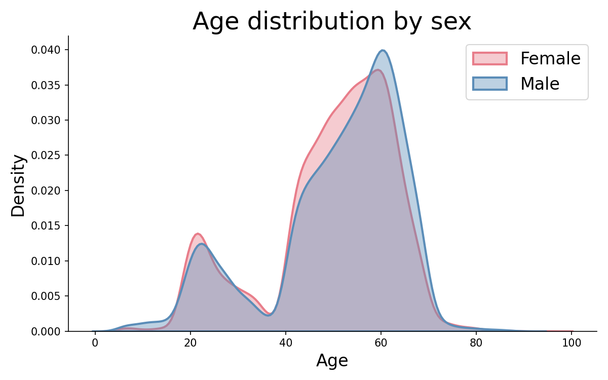

# Normative modeling of regional brain volumes

Normative models of regional gray matter and CSF volumes, fitted on ~54,000 healthy adults.
Given a new participant's age, sex and ROI volumes, a model gives, for each brain region,
how far that participant is from the healthy norm (a z-score). This github repository contains scripts that 
fit the models, compute z-scores for any new cohort (cross-sectional or with several sessions), and
plot and analyze them.

The settings at the top of the scripts use RLink as an example: bipolar patients before
(M00) and 3 months after (M03) lithium, comparing good responders (GR) to
partial/non-responders (PaR/NR).

## Method in short

- **Features**: ROI volumes from CAT12 v12.7 VBM, Neuromorphometrics atlas
  (140 gray matter + 140 CSF ROIs = 280), in cm³, scaled to a total intracranial volume
  of 1500 cm³.
- **Healthy controls**: from UK Biobank, OpenBHB, HCP and OpenNeuro.
- **Model** (`normative_models.py`): for each ROI, a Bayesian linear regression of
  volume on age (cubic B-splines) and sex. A participant's deviation from the norm is
  the z-score `z = (observed volume − predicted healthy value) / residual SD`, in cm³.
  Fitted on 90% of the controls, the other 10% held out to check that their z-scores
  have mean ≈ 0 and SD ≈ 1; the split is stratified on age decile, sex and site
  (`seed=42`).
  The saved models also apply a sinh-arcsinh warping to each ROI. 
- **Site correction** (optional): if the new cohort includes healthy controls scanned at
  its own sites, each site's mean control z-score per ROI is subtracted from the z-scores
  of that site (see below).
- **Extreme deviations** (`plot_extreme_deviations.py`): per ROI, the percentage of
  participants far below (z < −1.96) or far above (z > 1.96) the norm, tested against the
  2.5% expected per direction (binomial test, FDR-corrected), shown on glass brains with a
  color scale shared by all groups. GM "volumes" of the ventricles are left out
  (`ROIS_EXCLUDED_FROM_MAPS` in `config.py`): they're partial-volume voxels at the
  ventricle edges, and even healthy controls look "extreme" there.

## Atlas and CAT12 version

Everything here uses the **Neuromorphometrics atlas as computed by CAT12** (280 ROIs, with
CAT12 v12.7 naming). The healthy controls were processed with CAT12 v12.7 (UK Biobank,
OpenNeuro), v12.6 (HCP) and v12.7 (OpenBHB).

To use another CAT12 version:
1. Update that section of `config.py`: number of ROIs, ROI name conventions,
   `ROIS_OF_INTEREST` (the ROIs printed and plotted by the scripts) and
   `ROIS_EXCLUDED_FROM_MAPS`, all named in the CAT12 v12.7 format. Left/right-averaged
   names are derived from `ROIS_OF_INTEREST` automatically.
2. Rebuild the healthy control dataset and **refit the models**: the models in `models/`
   predict exactly the 280 CAT12 v12.7 ROIs, in a fixed order, and can't be reused.

The rest of the code doesn't change. New participants should be processed with CAT12 v12.7,
the version used for most of the healthy controls.

**Atlas files for the glass-brain maps**: `plot_extreme_deviations.py` uses the
Neuromorphometrics label image and its table, as distributed with CAT12 (the atlas CAT12
uses to compute the ROI volumes). Both are included in `data/atlas/`
(`neuromorphometrics.nii`, `neuromorphometrics.csv`), taken from the CAT12 repository
(`templates_volumes_old/` at tag 12.8.2,
[github.com/ChristianGaser/cat12](https://github.com/ChristianGaser/cat12)). In the image,
each ROI's label value is its `ROIid` in the table. SPM12's `labels_Neuromorphometrics.nii`
also works, with `ATLAS_LABEL_COLUMN = "ROIbaseid"` in `config.py`.

The Neuromorphometrics labels are released under a Creative Commons Attribution-NonCommercial
license (CC BY-NC): they can be reused for non-commercial purposes only, with credit. Labels
were derived from the MICCAI 2012 Grand Challenge and Workshop on Multi-Atlas Labeling. The
MRI scans originate from the OASIS project (http://www.oasis-brains.org/), and the labeled
data were "provided by Neuromorphometrics, Inc. (http://Neuromorphometrics.com/) under
academic subscription".

**Left/right averaged version**: averaging each `lX` / `rX` pair gives 138 ROIs, not 140:
276 of the 280 ROIs form 138 pairs, and the 4 ROIs without a left/right counterpart are
dropped (`fit_normative_model.mean_left_right_hemispheres` prints which).

## Repository

| File | What it does |
|---|---|
| `config.py` | Paths, atlas/ROI settings, model class, site correction. Edit this first. |
| `normative_models.py` | `NormativeBLR` class (fit, predict means and z-scores). |
| `make_dataset_healthy_controls.py` | Pools the healthy cohorts into one dataframe, plots their age distributions. |
| `fit_normative_model.py` | Fits the model (or loads it from `models/`), checks it on held-out controls, computes z-scores of new participants, optionally corrects them for site. |
| `plot_normative_curves.py` | Normative curve (mean ± 1 SD vs age, by sex) with the new participants overlaid, by group and session. |
| `plot_extreme_deviations.py` | For one session and each group, % of participants with extreme z-scores per ROI, tested against the norm, glass-brain maps. |
| `models/` | Fitted models (see below). |

## Pretrained models

| File | ROIs |
|---|---|
| `models/normative_BLR_BigHC_janv2026_280rois.pkl` | 280 (left and right separate) |
| `models/normative_BLR_BigHC_janv2026_280rois_mean_btw_hemispheres.pkl` | 138 (mean of left and right) |

Load them with `normative_models.py` importable:

```python
import pickle
import pandas as pd

with open("models/normative_BLR_BigHC_janv2026_280rois.pkl", "rb") as f:
    model = pickle.load(f)

X = pd.DataFrame({"age": [35.0, 52.0], "sex": ["female", "male"]})  # sex as "female"/"male"
Y = ...  # array (n_participants, 280): ROI volumes, TIV-scaled to 1500, same ROI order as the training data
predicted_values, zscores = model.predict(X, Y, return_zscores=True)
```

The ROI order is the column order of the healthy control dataframe
(`config.HC_DATAFRAME`), i.e. that of `OpenBHB_roi.csv` and of CAT12's ROI output. The
scripts select ROIs by name, so this only matters when calling the model directly.

## Using another model

`NormativeBLR` is the default. To fit another model, set `MODEL_CLASS`, `MODEL_PARAMS` and
`MODEL_NAME` in `config.py`, or pass `model_class` / `model_params` to
`fit_normative_model.fit_normative_model`. The class must implement:

- `fit(X, Y)`: `X` a DataFrame with columns `age`, `sex`; `Y` an array (n_participants, n_rois)
- `predict(X, Y=None, return_zscores=False)`: predicted healthy values (n_participants, n_rois),
  and the z-scores of `Y` if `return_zscores=True`
- `stds_`: per-ROI standard deviations (only needed by `plot_normative_curves.py`)

## New participants

`config.NEW_PARTICIPANTS` is a csv with one row per participant, or per participant and
session for longitudinal data, with columns:

- `participant_id`, `age`, `sex` (`"female"` / `"male"`)
- the ROI volumes, named as in the healthy control data and **TIV-scaled to 1500**
  (multiply each participant's ROIs by 1500 / TIV). CAT12 outputs unscaled volumes:
  without this step, all z-scores are shifted by head size.
- optionally `session`, and any other columns (group, site, ...), which are kept in the
  z-score file

`fit_normative_model.py` writes one z-score csv with the same rows and columns, ROI volumes
replaced by z-scores. Groups and sessions used by the plots are set at the top of
`plot_normative_curves.py` and `plot_extreme_deviations.py`.

### Site correction with local controls

The norm is fitted on many scanners, and therefore doesn't depend on any one of them.
However, a new site's scanner and protocol can still shift z-scores. If the new cohort includes
healthy controls scanned at the same sites, they can be used to find the scanner's 
relation to the estimated norm: set `LOCAL_CONTROLS = (column, value)` in
`config.py` (e.g. `("dx", "HC")`). For each site, `fit_normative_model.adjust_for_site`
subtracts the local controls' mean z-score per ROI from every participant of that site.

- Local controls are then at 0 on average by construction, and the other participants are
  effectively compared to them. WARNING: Don't use the controls' corrected z-scores in analyses that
  need them to be independent of the other groups' (e.g., classification of HC vs. illness).
- The offset is estimated with a standard error of about SD / √n, which every participant
  of the site inherits (~0.2 SD with 30 controls). Sites with fewer than
  `MIN_CONTROLS_PER_SITE` controls (30 by default) are left uncorrected, and a
  `site_adjusted` column records which rows were corrected.
- Only the mean is corrected, not the spread.

We chose this over hierarchical Bayesian regression (HBR; Kia et al., 2020, MICCAI;
Kia et al., 2022, PLOS ONE), which models site in the normative model itself: HBR needs the
site of every training scan, which large pooled datasets often don't have, and refits the
model for each new site. "Site" is also a vague proxy for what causes the effects (scanner
model, field strength, resolution, sequence, software version...), and can be confounded
with other variables, such as age when an age range is covered by a single cohort (e.g.,
UK Biobank above ~70 in our training data).

## Usage

Python 3.9–3.11. The versions are described in `requirements.txt`: the saved
models were pickled with scikit-learn 1.3.2, and newer scipy versions can't unpickle them.

```bash
python3.11 -m venv .venv && source .venv/bin/activate
pip install -r requirements.txt
```

`config.py` should be edited to include data paths etc., then the scripts should be run in this order:

```bash
python make_dataset_healthy_controls.py   # 1. only needed to rebuild the HC dataset 
python fit_normative_model.py             # 2. MEAN_HEMISPHERES must be modified if needed
python plot_normative_curves.py           # 3.
python plot_extreme_deviations.py         # 4.
```

`fit_normative_model.py` loads the model from `models/`. 
Delete or rename our given model to refit to your data.

## Data the normative model was trained on

The healthy control dataset (`make_dataset_healthy_controls.py`) contains 53,856 participants
from four sources: OpenBHB (Dufumier et al., 2022), UK Biobank (Miller et al., 2016),
OpenNeuro via the OpenNeuro collection (Markiewicz et al., 2021) and the Human Connectome
Project (Van Essen et al., 2013). The models in `models/` were fitted on 90% of them; the
other 10% were held out to check the z-scores (see "Method in short").

|                 | Total       | OpenBHB     | UK Biobank | OpenNeuro   | HCP        |
|-----------------|-------------|-------------|------------|-------------|------------|
| N               | 53,856      | 6,247       | 42,923     | 3,573       | 1,113      |
| Age (mean ± SD) | 50.2 ± 13.8 | 33.9 ± 18.4 | 55.0 ± 7.5 | 28.0 ± 13.7 | 28.8 ± 3.7 |
| Female (%)      | 52.9%       | 51.8%       | 52.7%      | 56.4%       | 54.4%      |

The age distribution is bimodal: a smaller peak in the early twenties (mostly OpenBHB,
OpenNeuro and HCP) and a large peak between about 40 and 70 (mostly UK Biobank). The curves
are therefore best constrained in those age ranges, and less reliable in childhood, between
about 35 and 40, and above 70. Datasets covering these ages would improve the model.

<p align="center">
  
  <br>
  <em>Age distribution of the 53,856 healthy participants, by sex (kernel density).</em>
</p>

No subject-level data is included in this repository (`data/` and `results/` are
git-ignored, except the atlas files). The healthy cohorts require their own data access
agreements (UK Biobank, HCP, OpenBHB, OpenNeuro).

### References

- Dufumier B, Grigis A, Victor J, Ambroise C, Frouin V, Duchesnay E. OpenBHB: a large-scale multi-site brain MRI data-set for age prediction and debiasing. *NeuroImage*. 2022;263:119637. [doi:10.1016/j.neuroimage.2022.119637](https://doi.org/10.1016/j.neuroimage.2022.119637)
- Miller KL, Alfaro-Almagro F, Bangerter NK, et al. Multimodal population brain imaging in the UK Biobank prospective epidemiological study. *Nat Neurosci*. 2016;19(11):1523-1536. [doi:10.1038/nn.4393](https://doi.org/10.1038/nn.4393)
- Markiewicz CJ, Gorgolewski KJ, Feingold F, et al. The OpenNeuro resource for sharing of neuroscience data. *eLife*. 2021;10:e71774. [doi:10.7554/eLife.71774](https://doi.org/10.7554/eLife.71774)
- Van Essen DC, Smith SM, Barch DM, Behrens TEJ, Yacoub E, Ugurbil K. The WU-Minn Human Connectome Project: an overview. *NeuroImage*. 2013;80:62-79. [doi:10.1016/j.neuroimage.2013.05.041](https://doi.org/10.1016/j.neuroimage.2013.05.041)

## Author

Sara Petiton. Developed during a PhD in the Signatures team, GAIA lab, NeuroSpin (CEA),
Université Paris-Saclay.
